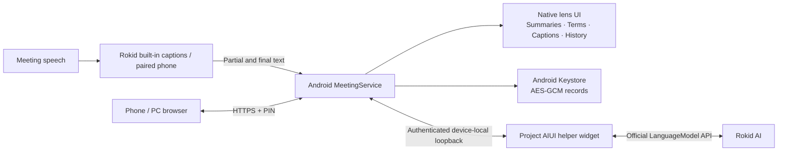

# Rokid Conversate

### Bringing the Even Realities G2 Conversate experience to Rokid.

[한국어](README.md) · [English](README.en.md)

**Turn your glasses from a transcription display into a companion that helps you understand and remember the conversation.**

Rokid Conversate connects the built-in speech recognition on Rokid Glasses with Rokid AI. Inspired by **the glanceable conversation assistance of Even Realities G2 Conversate**, it brings speech-group summaries, terminology explanations, swipeable history, preparation notes and post-meeting records together in a native Rokid app.

The point is to help you stay in the conversation: **glance at a short summary near the top of the lens, then swipe the frame to revisit what you missed.** Live transcription is optional on the display; recording the final text and generating summaries can continue with captions hidden.

> Current version: **0.3.0-device-language**. Native Android app + device-hosted web companion + Rokid AIUI helper widget. This is an independent, unofficial project, not a product or partnership of Even Realities or Rokid. It reimplements the core interaction experience on Rokid and does not claim complete feature or performance parity with the original product.

## No third-party AI API key. Local app + Rokid AI.

**The app does not directly call OpenAI, Claude or another separate third-party AI API. There is no developer API key to enter and no application backend to host.** The native app, encrypted records and web companion live on the glasses; speech recognition and generation use Rokid's built-in STT and Rokid AI.

“Local” describes the app, storage, companion and helper transport. The helper uses Rokid's official host capability, so **this is not a zero-API or fully offline AI claim**. Rokid's phone/cloud connectivity and service policies can still apply.

> **Current setup is a developer preview: installing the APK alone does not provision the AI helper.** The Windows ZIP still uses the ADB/Node.js developer deployment route. See [APK-only setup limits and the official distribution alternative](docs/SETUP-LIMITS.md).

## Install without building

**[Download the v0.3.0 preview](https://github.com/hardline7/Rokid-Conversate/releases/tag/v0.3.0)** · [English setup guide](docs/INSTALL.en.md) · [한국어 설치 안내](docs/INSTALL.ko.md)

| Download | Purpose |
|---|---|
| [Windows Setup ZIP](https://github.com/hardline7/Rokid-Conversate/releases/download/v0.3.0/Rokid-Conversate-v0.3.0-Windows-Setup.zip) | **Recommended:** APK + AI helper + automatic installer + both language guides |
| [APK](https://github.com/hardline7/Rokid-Conversate/releases/download/v0.3.0/Rokid-Conversate-v0.3.0.apk) | Manual APK installation; the AI helper is installed separately |
| [SHA256SUMS.txt](https://github.com/hardline7/Rokid-Conversate/releases/download/v0.3.0/SHA256SUMS.txt) | Download checksums |

On Windows, install **ADB and Node.js 20+**, fully extract the ZIP, and run this from its folder. Android Studio, JDK and an Android build are not required.

```powershell
powershell -NoProfile -ExecutionPolicy Bypass -File .\Install-Conversate.ps1
```

The installer sets up both the APK and Rokid AI widget. Authorize USB debugging and keep the Rokid phone paired. End meetings before updating. This is a **development/debug-signed preview APK**, required by the current helper setup method. Read the [signing and update notes](docs/INSTALL.en.md#updates-and-signing) before replacing a build signed with a different key.

## What you get

| Feature | What it does |
|---|---|
| **Speech-group summaries** | Rokid AI condenses a group of finalized utterances into a short card at the top of the lens. |
| **Swipeable summary history** | Swipe to previous and next summaries. Reading an older card stays pinned even when another summary arrives. |
| **Terminology explanations** | Briefly explains specialized terms actually present in the speech, with validation intended to omit uncertain or vague definitions. |
| **Optional live captions** | Turn displayed captions on or off independently of final transcript storage and summary generation. |
| **AI cues** | Answers, people information, concepts and suggestions. Answers and people information require supporting quotations from selected notes. |
| **Prep notes** | Write meeting background and questions, or import TXT, Markdown and text-based PDFs. |
| **Local web companion** | Manage notes, meeting controls, complete transcripts and settings from a phone or PC browser on the same network. No separately hosted web backend. |
| **Records and recaps** | Keep speech-group cards, the meeting summary, cues and the complete transcript; search and export Markdown. |
| **Rokid language integration** | The lens UI, web companion and new AI output follow the glasses' active system language. |
| **Encrypted storage** | Meeting text, notes and settings are stored on the glasses using Android Keystore-backed AES-GCM. |

## More than a scrolling transcript

A long transcript still makes you read continuously during a meeting. What made Conversate compelling to us was the connection between **remembering the conversation and getting useful assistance right now**.

This project recreates that flow:

1. **Before:** Prepare the background, figures and questions; select the notes for this meeting.
2. **During:** Keep listening and glance at the current summary or a useful term explanation.
3. **When you miss something:** Swipe back through the summaries immediately.
4. **After:** Review the full transcript, summaries and cues, then export what you need.

**Making that experience work on an actual pair of Rokid glasses, using Rokid's own STT and AI, is the achievement behind this project.**

## How it behaves during a meeting

### Speech is grouped, then summarized

The app requests a new group summary when the first of these conditions is met:

- About **3 seconds** have passed since the last recognition event.
- About **25 seconds** have passed since the first pending finalized utterance.
- **6 finalized utterances** are waiting for a summary.

Long inputs are processed sequentially in chunks of up to eight utterances and roughly 2,400 characters. A single longer utterance can still be sent as a whole. A failed request does not advance the processed cursor; the group can be retried. Remaining finalized speech is also handled when a meeting ends.

These are **request scheduling thresholds**, not end-to-end latency guarantees. STT finalization, helper availability, network latency and Rokid AI generation add time. This is not perfect semantic segmentation or speaker diarization.

### The summary stays visible; your reading position is respected

The main lens view keeps the selected summary near the top. Recent captions appear at the bottom when enabled. Swiping to an older card pins that selection. Returning to the newest card resumes following new summaries.

### Explanations and answers are checked

A term must actually occur in the speech and satisfy confidence and length checks. Answers and Bios must reference an existing selected note and an exact supporting quotation; numeric tokens are compared with the quote as well.

These checks reduce some failure modes; model-reported confidence is not proof of accuracy. Misrecognized abbreviations or names can still lead to missing or incorrect explanations. Check consequential information against the original transcript and source material.

## Architecture



| Component | Responsibility |
|---|---|
| `MeetingService` | Recognition ownership, meeting lifecycle, final-utterance draining, AI scheduling and companion APIs. |
| `RokidSttClient` | Connects to the existing caption service through a private Binder/GATT route. |
| `LiveSummaryPolicy` | Groups pending speech, validates summary cards and terms, and defines summary navigation. |
| `MeetingLensView` | Draws glanceable information within the measured safe area of the 480×640 display. |
| `RokidRelayAi` + AIUI widget | Uses a project-owned host helper to access Rokid's language model from the ordinary APK. |
| `MeetingStore` + `Vault` | Encrypted storage, utterance corrections and deduplication, interrupted-record recovery and exports. |
| `CompanionServer` | Device-hosted HTTPS interface and authenticated APIs. |
| `L10n` + web `i18n.js` | Device language detection, interface translation caching and separation of UI messages from user content. |

The STT connection uses a **private interface**. The AI helper uses Rokid's **official AIUI `LanguageModel` capability**. The design does not require rooting, changing system signatures or extracting Rokid account credentials to bypass the ordinary APK's AI restrictions.

## Why this approach is useful

- **Uses the existing Rokid speech path.** It reuses the built-in captions and paired phone rather than building another microphone capture pipeline.
- **No separate external LLM API key.** No Claude, OpenAI or other additional generative AI provider is required. Availability, account limits, costs and policies remain subject to Rokid.
- **Less reading during the conversation.** Short summaries and useful context replace the need to watch an endless transcript.
- **No web server to operate.** The glasses serve their own companion. Your phone or computer needs a browser.
- **Preparation stays connected to the meeting.** Selected notes are snapshotted per session. Meeting recaps use actual transcript evidence rather than treating preparation documents as agreed decisions.
- **AI interruptions do not inherently stop text storage.** While the recognition path remains available, captions and finalized text storage work independently of AI requests. STT itself still depends on the Rokid phone connection.
- **Language is part of the experience.** The glasses' active language drives the UI and new AI output, instead of forcing everyone into Korean or choosing a different language in the browser.

## Requirements for building from source

The device verified so far is **Rokid RG_glasses running Android 12 / API 32**. This is not a universal SDK app tested across every Rokid model or firmware.

You will need:

- Compatible Rokid glasses paired with the Rokid phone app.
- An account and connectivity that can use Rokid captions and AI.
- A USB-connected computer authorized for ADB debugging.
- **JDK 17 or newer**; this project was verified with JDK 21.
- Android SDK **Platform 35**, **Build Tools 35.0.0** and **platform-tools/ADB**.
- Node.js/npm and Windows PowerShell for the helper installer.
- A phone or PC browser able to reach the glasses on the same network.

Accept the SDK licenses through Android SDK Manager. The included Gradle Wrapper obtains Gradle 8.11.1.

## Developer setup: build from source

### 1. Clone the project

```powershell
git clone https://github.com/hardline7/Rokid-Conversate.git
cd Rokid-Conversate
```

This public repository can be cloned without authentication. Pushing changes requires GitHub write access. Do not put a personal access token into the source tree or a saved remote URL.

### 2. Point the build at your Android SDK

Create an untracked `local.properties` file in the project root:

```properties
sdk.dir=C:/Users/YOUR_NAME/AppData/Local/Android/Sdk
```

Then check the connection:

```powershell
adb devices -l
```

Accept the USB debugging prompt on the glasses and confirm their state is `device`. If more than one device is connected, add `-s <device-id>` to the ADB commands below.

### 3. Build and install the Android app

```powershell
.\gradlew.bat testDebugUnitTest lintDebug assembleDebug
adb install -r app/build/outputs/apk/debug/app-debug.apk
adb shell am start -W -n app.conversate.glass/.meeting.MeetingActivity
```

On macOS/Linux, use `./gradlew` for the Android build. The helper installer has been verified on Windows. The current workflow uses a development debug APK.

### 4. Install the Rokid AI helper

Do this while no meeting is active:

```powershell
.\tools\rokid-ai\Install-Helper.ps1
# If multiple devices are connected:
.\tools\rokid-ai\Install-Helper.ps1 -Serial <device-id>
```

The script automatically selects a single connected device, prepares the pinned official AIX CLI and installs and launches the project widget. It enables Developer Mode, briefly opens the launcher to attach the widget, then returns to the native meeting view. Developer Mode remains enabled for the helper.

The helper's secret is **a random local connection token generated by this app**, not a Rokid account credential. Wait for **Rokid AI connected** on the glasses. Normal use relies on Widget mode; `-Page` is a diagnostic card that can cover the meeting UI.

### 5. Connect the web companion

Open the address shown on the glasses, `https://<glasses-ip>:8443`, in your browser. The device generates its own certificate, so an initial certificate warning is expected. Confirm that the address belongs to your glasses, allow that device connection, and enter the **current six-digit PIN displayed on the glasses**.

The PIN changes when the app service restarts. There is no permanent PIN in this README.

## Your first meeting

1. **Prepare:** Add or import notes and select the documents for the meeting.
2. **Check connections:** Confirm STT and Rokid AI status. The Settings page offers a synthetic AI connection test.
3. **Inform participants:** Let them know that the conversation will be recorded as text and processed with Rokid AI.
4. **Start:** Tap once for the confirmation screen and again to confirm, or start through the companion.
5. **Talk:** Glance at the summaries; swipe back when you need to revisit a point.
6. **End:** Confirm on the glasses or use the web control. The app waits briefly for final recognition results before closing the record.
7. **Review:** Browse Speech groups, Summary, Cue List and Transcription, then export Markdown.

### Glasses controls

| Input | Action |
|---|---|
| Tap while idle | Open start confirmation. |
| Tap on start confirmation | Confirm participant notification and start. |
| Tap during a meeting | Cycle Summary → Cue → Notes. |
| Swipe forward/back | Next/previous summary, cue or note page in the current view. |
| Double tap | Dismiss the current cue, cancel a confirmation or open end confirmation, depending on state. |
| Tap while paused | Resume the same meeting. |

The meeting pauses when the display sleeps or the app leaves the foreground. Returning to the app does not silently restart recognition. Ten minutes without recognized speech ends the meeting automatically.

## Notes and records

- Import UTF-8 TXT, Markdown and PDFs containing text. **Scanned-PDF OCR is not included.**
- Maximum file size: 8 MB; PDF length: 200 pages; extracted note text: 60,000 characters.
- Up to 100 prep notes, with a maximum of 100,000 characters across selected notes.
- Only extracted text is retained, not the uploaded original. PDF text includes markers such as `[p.1]`.
- The web companion loads the **complete transcript**, separately from the lens's recent-utterance preview. It preserves your reading position while new speech arrives and offers beginning/latest navigation.
- Interrupted sessions are recovered as interrupted records. This project does not provide a backup service capable of recovering encrypted records after app removal or loss of the Keystore key.

## Languages

Korean and English interface messages are built in. For other languages, the connected Rokid AI translates application messages and caches them on the glasses. English appears while translation is being prepared or AI is unavailable. The Settings page shows the detected language and preparation status.

New summaries, generated titles, cues and term definitions are requested in the glasses' current language. **Existing transcripts, notes, previous generated results and exact source quotations keep their original text.** Recognition language remains controlled by Rokid's built-in caption/phone settings. Not every language has been manually reviewed. See [LANGUAGES.md](docs/LANGUAGES.md).

## Where your data goes

Meeting text, notes and settings are encrypted on the glasses. This application does not store microphone audio files. The companion uses HTTPS, PIN authentication, session cookies, Origin checks and upload limits. The AI helper transport is authenticated and bound to `127.0.0.1`.

**Local storage does not mean fully offline processing.** Recognition and meeting AI use the paired Rokid phone/services; selected notes and transcripts may be sent as part of the relevant AI task. Rokid's server processing, account limits and retention policies are outside this app's control. Interface translation sends application-owned UI messages only.

Personal meeting records, runtime tokens, device captures, extracted system APKs/libraries and local SDK installations are not included in this repository.

## Validation and current limits

Current main passes **34 JVM tests, Android lint and the APK build**. The published v0.3.0 passed 29 tests; subsequent source changes harden language classification and catalogue coverage and are not yet included in that downloadable APK. Real-device checks cover STT reception; start, pause, resume and end transitions; real AI responses; lens summary display and persistence; HTTPS access; and preservation of existing meeting records. Desktop/mobile browser tests cover full-transcript scrolling, English UI and live Japanese label updates. Real Rokid AI translation responses were checked for Japanese and Spanish.

The following are still open validation work:

- Compatibility with every Rokid model and firmware.
- Actual device-language switching tests and human translation review across all languages.
- Extended physical swipe usability testing.
- A 60-minute battery/stability run and three complete real meetings.
- Guaranteed summary latency or accuracy for all inputs.

See [BUILD-STATUS.md](docs/BUILD-STATUS.md) for the detailed implementation and validation record. Firmware changes can break the private STT interface.

## Development and tests

```powershell
# Android unit tests, lint and APK
.\gradlew.bat testDebugUnitTest lintDebug assembleDebug

# Browser dependencies and Chromium
npm ci
npx playwright install chromium
npm run test:web
npm run test:web:mobile
```

To use an installed Chrome instead, set `$env:PLAYWRIGHT_CHANNEL='chrome'` in PowerShell. Some phases of `tools/meeting_smoke.py` start or stop recognition and change synthetic test notes; do not run them during a real meeting.

```text
app/src/main/java/app/conversate/glass/
  meeting/                 Service, lens UI, storage, HTTPS, AI and languages
  stt/                     Rokid STT client and transcript parser
  probe/                   Initial display/input measurement tools
app/src/main/assets/companion/  Web companion
app/src/test/              JVM regression tests
tools/rokid-ai/helper/     Project AIUI helper sources
tools/rokid-ai/Install-Helper.ps1
tools/test_*.cjs           Browser regression tests
docs/                     Usage, design and validation notes
```

## Troubleshooting

| Symptom | What to check first |
|---|---|
| Companion will not open | Current address/port shown on the glasses, network reachability, device power and app state. |
| PIN rejected | A service restart generates a new PIN; use the current one. |
| No captions arrive | Paired Rokid phone connection, native captions and recognition language. |
| AI is waiting | Briefly open Home and return to attach the widget, or reinstall the helper after ending the meeting. |
| Summaries or terms are missing/slow | AI/network availability, finalized speech and Summary/Cue settings. |
| English appears in another language | Check interface translation status and AI connectivity. English is the preparation fallback. |
| Imported PDF has no text | Scanned images need a separate OCR step first. |

## Further reading

- [Detailed usage — Korean](docs/USAGE.md)
- [Implementation and validation record — Korean](docs/BUILD-STATUS.md)
- [Product goals — Korean](docs/PRD.md)
- [STT design and investigation notes — Korean](docs/ROKID-STT.md)
- [AI helper installation and protocol](tools/rokid-ai/README.md)
- [Language behavior](docs/LANGUAGES.md)
- [Official Rokid LanguageModel documentation](https://open.rokid.com/aiui/api/ai/language-model?lang=en-US&version=0.19.0)

**A Conversate-inspired conversation assistant, made to work on Rokid. Spend your next meeting following the discussion, with the important context just a glance away.**
