# Rokid Conversate

### Even Realities G2 Conversateの会話サポート体験を、Rokidでも。

[한국어](README.md) · [English](README.en.md) · [日本語](README.ja.md)

**文字起こしを読むためのメガネから、会話を理解し、振り返るためのメガネへ。**

Rokid Conversateは、Rokidメガネの標準音声認識とRokid AIを組み合わせた会議支援アプリです。Even Realities G2 Conversateの「会話中に必要な情報をさっと確認する体験」を参考に、発話ごとの要約、専門用語の解説、履歴のスワイプ操作、事前資料、会議後の記録をRokid上で実装しています。

上部の短い要約を確認し、聞き逃した流れはフレームをスワイプして読み返せます。リアルタイム字幕の表示をオフにしても、確定した文字起こしの保存や要約生成は続けられます。

> 現在のバージョン：**0.3.4-concepts**。Androidネイティブアプリ、メガネ内のWeb管理画面、Rokid AIUIヘルパーウィジェットで構成されています。独立した非公式プロジェクトであり、Even RealitiesまたはRokidの公式製品・提携アプリではありません。元製品とすべての機能・性能が同等であるとは主張していません。

## 外部AI APIキー不要。ローカルアプリとRokid AIを利用

**アプリからOpenAI、Claudeなど別の外部AI APIを直接呼び出すことはありません。APIキーの入力や、専用バックエンドの運用も不要です。** アプリ、暗号化記録、Web管理画面はメガネ内に置き、音声認識と文章生成にはRokid標準STTとRokid AIを使います。

「ローカル」はアプリ、保存先、管理画面、ヘルパーとの通信を指します。**AI処理まで完全オフライン、あるいはAPI呼び出しが一切ないという意味ではありません。** Rokidのスマートフォン接続、クラウド、アカウント、サービスの利用条件が適用される場合があります。

## 主な機能

| 機能 | 内容 |
|---|---|
| 発話単位の要約 | 確定した発話をまとめ、レンズ上部の短いカードで表示。 |
| 要約履歴 | スワイプで前後へ移動。過去の要約を読んでいる間は、新着で位置を変えません。 |
| 専門用語の解説 | 実際に発話された用語を文脈から分析し、短く説明。 |
| 任意の字幕表示 | 保存や要約生成とは別に、リアルタイム字幕の表示を切り替え。 |
| AI Cue | 回答、人物、概念、提案。回答・人物情報には選択済み資料の引用が必要。 |
| 事前資料 | 背景や質問を記入し、TXT、Markdown、テキストPDFを取り込み。 |
| Web管理画面 | 同一ネットワークのスマートフォン・PCから資料、会議、全文、設定を管理。 |
| 記録と振り返り | 発話要約、会議要約、Cue、全文を保存。検索とMarkdown出力に対応。 |
| Rokidの言語に追従 | メガネの言語設定に合わせてUIと新しいAI出力を切り替え。 |
| 暗号化保存 | Android Keystoreに基づくAES-GCMで、会議本文・資料・設定を保管。 |

## 会話に出てきた専門用語を、その場で解説

RAGなどの新しい専門用語が出てくると、Rokid AIが文脈に合った短い説明を要約の下に表示します。意味を検索したり質問したりするために会話を中断することを減らします。

- 用語分析は要約生成とは別に動作します。要約をオフにしていても、AI Cueが有効なら利用できます。
- 同じ概念を会議中に繰り返し表示しないようにし、表示頻度も制限します。
- 新しいCueは約9秒表示され、AI Cueタブに点が付きます。タップで詳細画面へ切り替え、スワイプで保存済みのCueを確認できます。
- 設定の「Cue自動表示」をオフにしても、Cue一覧には残ります。AI Cue自体をオフにすると分析も停止します。
- 用語、発話ID、言及箇所が実際の入力にあるかを検証します。解説は**モデルの一般知識**であり、リアルタイムのWeb検索で検証された情報ではありません。

[G2の公開資料の調査、実装、検証、制限](docs/CONCEPT-CUES.md)

## アプリを開いたときに会議機能を開始

メニューからConversateを開くと、音声認識サービスへの接続、HTTPS管理画面、AIタスクの接続が始まります。ホームへ戻るなどしてアプリ画面を閉じると、認識を停止し、記録を保存して会議サービスとWebサーバーを終了します。**終了後に30秒ごとの点検やAIジョブの定期取得は行いません。** 最後の確定発話を受け取るため、終了処理には最大約2.5秒かかる場合があります。

再実行の通知を受け取る受動的なローカル接続は残りますが、定期的なpingや再接続タイマーはありません。プロセスとソケットが完全に消えるわけではなく、消費電力ゼロを保証するものでもありません。

**メガネの再起動、強制終了、OSによるプロセス回収後のAI自動再接続は、まだ実装されていません。** その場合はアプリを開いてから、PCでAIヘルパーのセットアップスクリプトを再実行してください。[動作と検証の制限](docs/POWER.md)

## ビルドせずにインストール

**[v0.3.4プレビューをダウンロード](https://github.com/hardline7/Rokid-Conversate/releases/tag/v0.3.4)**

| ダウンロード | 用途 |
|---|---|
| [Windows Setup ZIP](https://github.com/hardline7/Rokid-Conversate/releases/download/v0.3.4/Rokid-Conversate-v0.3.4-Windows-Setup.zip) | **推奨。** APK、AIヘルパー、自動インストーラー、韓国語・英語ガイドを収録。 |
| [APK](https://github.com/hardline7/Rokid-Conversate/releases/download/v0.3.4/Rokid-Conversate-v0.3.4.apk) | 手動導入用。AIヘルパーは別途セットアップが必要。 |
| [SHA256SUMS.txt](https://github.com/hardline7/Rokid-Conversate/releases/download/v0.3.4/SHA256SUMS.txt) | ダウンロードファイルのチェックサム。 |

**現在は開発者向けプレビューです。APKだけではAIヘルパーの初回セットアップは完了しません。** Windows Setup ZIPもADBとNode.jsを使う開発者向け導入方法です。[APK単独導入の制限](docs/SETUP-LIMITS.md)も確認してください。

Windowsで**ADBとNode.js 20以上（npmを含む）**を準備し、ZIPを専用フォルダーに完全に展開して、そのフォルダーで実行します。公開APKを使う場合、Android Studio、JDK、アプリのビルドは不要です。

```powershell
powershell -NoProfile -ExecutionPolicy Bypass -File .\Install-Conversate.ps1
```

インストーラーはAPKとRokid AIウィジェットの両方を導入します。USBデバッグを承認し、スマートフォンのRokidアプリとのペアリングを維持してください。更新前に会議を終了してください。

現在のAPKは、ヘルパーの開発導入方式で必要な**開発用/debug署名のプレビュー版**です。署名が異なるAPKでは上書きできない場合があります。記録を守るため、署名不一致を理由に自動でアンインストールしないでください。[署名と更新の説明（英語）](docs/INSTALL.en.md#updates-and-signing)

## Codex・Claude Codeにインストールを依頼する

PCでターミナルを実行できるCodex、Claude Codeなどに、以下のプロンプト全体をコピーしてください。メガネはUSBデータケーブルで接続し、Rokidのスマートフォンアプリとペアリングしておきます。

インストールを手伝うAIと、会議アプリが利用するRokid AIは別です。この方法でもAPK単独導入になるわけではありません。USBデバッグの承認など、本人の操作が必要な場面ではAIの案内に従ってください。

```text
PCにUSB接続したRokidメガネに、Rokid ConversateとAIヘルパーを導入してください。
手順を説明するだけで終わらず、実行できる作業は実際に進めてください。

プロジェクト: https://github.com/hardline7/Rokid-Conversate
対象リリース: https://github.com/hardline7/Rokid-Conversate/releases/tag/v0.3.4
日本語の説明: README.ja.md
詳細な導入ガイド: docs/INSTALL.en.md
導入上の制限: docs/SETUP-LIMITS.md

1. OS、既存ツール、ADB、Node.js/npm、接続済みデバイスを確認してください。
   公開APKを使用し、不要なAndroid Studio、SDK全体、JDKの導入やビルドは避けてください。
2. Windowsで必要なツールがなければ、公式配布元からPlatform-ToolsとNode.js 20以上を
   準備してください。他のOSでは対応範囲を先に確認してください。
3. v0.3.4のWindows Setup ZIPとSHA256SUMS.txtを取得し、SHA-256を検証して展開してください。
   GitHubのSource code ZIPとセットアップ用ZIPを取り違えないでください。
4. adb devices -lで対象のメガネを確認してください。複数ある場合は対象を確認し、
   USBデバッグの承認が必要なら操作方法を案内してください。
5. 実行中の会議を中断しないでください。更新前に会議の終了を確認してください。
   データ削除や自動アンインストールはせず、署名不一致なら停止して選択肢を説明してください。
6. 展開したインストーラーとガイドを読んでから、Windowsでは対象を指定して実行してください。
   powershell -NoProfile -ExecutionPolicy Bypass -File .\Install-Conversate.ps1 -Serial <確認したデバイスID>
   この処理はAPKとAIウィジェットを導入し、開発者モードを有効にします。
7. 別のAIプロバイダーやAPIキーをアプリに追加しないでください。公開リリースの取得に
   GitHubトークンは不要です。認証情報、ローカル接続用秘密値、会議本文を公開しないでください。
8. アプリ起動、ヘルパー接続、実際のAI利用可否を確認してください。必要なら会議をしていない
   状態で合成入力の接続テストを使い、実際の会議を勝手に開始しないでください。
9. 導入したバージョン、確認結果、残る問題を報告してください。同じネットワークから表示中の
   HTTPSアドレスを開き、現在のPINで接続する方法も説明してください。
   インストールコマンドの成功だけでAI接続成功と判断しないでください。

会議アプリはローカル保存、Rokid標準STT、Rokid AIを使用します。
別の外部AI APIキーは不要ですが、Rokidのスマートフォン・サービス接続が必要な場合があります。
```

## 初めての会議

1. **準備：** Web管理画面で資料を追加・選択します。
2. **接続確認：** STTとRokid AIの状態を確認します。設定画面には合成入力の接続テストがあります。
3. **参加者への説明：** 会話を文字として保存し、Rokid AIで処理することを伝えてください。
4. **開始：** タップで確認画面へ進み、もう一度タップして開始します。Webからも開始できます。
5. **会話：** 上部の要約や用語を確認し、必要なときだけスワイプで読み返します。
6. **終了：** メガネまたはWebで終了操作をします。最後の確定発話を短時間待って記録を閉じます。
7. **振り返り：** 発話要約、会議要約、Cue一覧、全文を確認し、Markdownで出力します。

### メガネの操作

| 操作 | 動作 |
|---|---|
| 待機中にタップ | 開始確認画面を開く。 |
| 開始確認でタップ | 参加者への通知を確認して会議開始。 |
| 会議中にタップ | 要約 → AI Cue → 資料の順に画面を切り替え。 |
| 前後へスワイプ | 現在の画面内で、前後の要約・Cue・資料ページを表示。 |
| ダブルタップ | 状態に応じてCueを閉じる、確認を取り消す、終了確認を開く。 |
| 一時停止中にタップ | 保持されている会議を再開。 |

アプリ画面を閉じると認識とサービスを終了し、進行中の記録は中断扱いで保管します。戻っただけで認識を再開することはありません。認識された発話が10分間ない場合は自動終了します。

### Web管理画面への接続

メガネに表示された `https://<メガネのIP>:8443` を、同じネットワークのブラウザーで開きます。メガネが生成した証明書を使うため、初回は証明書の警告が出る場合があります。自分のメガネのアドレスであることを確認して接続し、**メガネに表示中の6桁PIN**を入力してください。

PINはサービスの再起動で変わります。固定PINはありません。アプリを閉じている間はWeb管理画面にも接続できません。

## 資料と記録

- UTF-8のTXT、Markdown、文字を含むPDFに対応。**スキャンPDFのOCRは含みません。**
- ファイルは最大8MB、PDFは最大200ページ、抽出本文は資料ごとに最大60,000文字。
- 事前資料は最大100件。選択した資料の本文合計は最大100,000文字。
- 元ファイルは保存せず、抽出した本文を保存します。PDFには `[p.1]` などのページ表記が付きます。
- 選択資料は会議ごとにスナップショット化します。会議後の要約は実際の発話を基に生成します。
- Webではレンズの数行表示とは別に**全文**を読めます。新しい発話が増えても読む位置を保ちます。
- アプリの削除やKeystore鍵の喪失後に記録を復元するバックアップサービスはありません。

## 日本語とその他の言語

**このREADMEは日本語ですが、日本語UIが固定翻訳として内蔵されているという意味ではありません。** 韓国語と英語のUIは内蔵されています。それ以外の言語では、接続中のRokid AIが表示文言を翻訳し、メガネにキャッシュします。準備中やAIが使えないときは英語が表示されます。

新しい要約、タイトル、Cue、用語解説はRokidの現在の言語で生成するよう要求します。既存の文字起こし、資料、過去の結果、引用文は元の言語のままです。認識言語はRokid標準字幕とスマートフォン側の設定に従います。すべての言語を人手で確認済みではありません。[言語の仕様](docs/LANGUAGES.md)

## アーキテクチャ

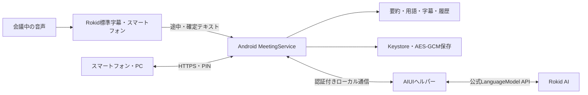

| コンポーネント | 役割 |
|---|---|
| `MeetingService` | 認識、会議の開始・終了、最後の発話受信、AIタスクとWeb APIの管理。 |
| `RokidSttClient` | 非公開のBinder/GATT経路で既存字幕サービスと接続。 |
| `LiveSummaryPolicy` | 発話のグループ化、要約カードの検証、要約履歴の移動。 |
| `CueTriggerPolicy` / `CuePolicy` | 分析タイミング、用語の根拠、重複と表示頻度の制御。 |
| `MeetingLensView` | 480×640画面の安全な表示領域に描画。 |
| `RokidRelayAi` / AIUIウィジェット | ヘルパーを介してRokid AIを利用。 |
| `MeetingStore` / `Vault` | 暗号化保存、発話訂正、重複排除、中断記録の復旧、出力。 |
| `CompanionServer` | メガネ内のHTTPS管理画面と認証付きAPI。 |
| `L10n` / `i18n.js` | 言語検出、UI翻訳キャッシュ、ユーザー本文との分離。 |

STTは**非公開インターフェース**を使うため、ファームウェア更新で動作が変わる場合があります。AIヘルパーはRokidの**公式AIUI `LanguageModel` 機能**を使います。root化、システム署名変更、Rokidアカウント認証情報の抽出は必要としていません。

この構成なら、別のマイク録音処理やWebサーバーを運用せず、Rokidの既存音声経路を活用できます。短い要約と必要な情報を見ながら、準備、会話、振り返りを一つの流れとして使えます。認識経路が利用できる間は、AIの応答待ちとは独立して確定テキストを保存できます。

## ソースからビルドする場合

確認済み機器は**Android 12 / API 32のRokid RG_glasses**です。全モデル・全ファームウェアで検証済みではありません。

必要なもの：対応メガネ、Rokidスマートフォンアプリと利用可能なアカウント・接続、USBデバッグを承認したPC、**JDK 17以上（検証はJDK 21）**、Android SDK Platform 35、Build Tools 35.0.0、platform-tools/ADB、Node.js/npm。ヘルパースクリプトはWindows PowerShellで検証しています。

```powershell
git clone https://github.com/hardline7/Rokid-Conversate.git
cd Rokid-Conversate
```

未追跡の `local.properties` にSDKの場所を設定します。

```properties
sdk.dir=C:/Users/YOUR_NAME/AppData/Local/Android/Sdk
```

SDKライセンスを承認してから実行します。Gradle WrapperはGradle 8.11.1を取得します。

```powershell
adb devices -l
.\gradlew.bat testDebugUnitTest lintDebug assembleDebug
adb install -r app/build/outputs/apk/debug/app-debug.apk
adb shell am start -W -n app.conversate.glass/.meeting.MeetingActivity

# 会議を終了した状態でヘルパーを導入
.\tools\rokid-ai\Install-Helper.ps1
# 複数のデバイスがある場合
.\tools\rokid-ai\Install-Helper.ps1 -Serial <device-id>
```

macOS/LinuxのAndroidビルドでは `./gradlew` を使用します。Windows用ヘルパースクリプトが他のOSで動作するとは限りません。

ヘルパー導入では公式AIX CLIを準備し、ウィジェットを導入して開発者モードを有効にします。一度ランチャーを表示してから会議アプリへ戻ります。ローカル接続用秘密値はアプリが生成したもので、Rokidアカウントの認証情報ではありません。通常はWidgetモードを使用します。`-Page` は会議画面を覆う場合がある診断用カードです。

## 検証と制限

**JVMテスト43件、Android lint、APKビルド**を通過しています。韓国語・英語の42画面を実機フォントで描画し、単色表示と安全領域を確認しました。合成RAG発話による実際のRokid AIの解説も検証済みです。Webでは全文スクロール、英語UI、日本語表示への更新、Cue自動表示設定の保存などを確認しています。

日本語・スペイン語の実際のAI翻訳応答は確認しましたが、全言語の端末切り替えや自然さを人手で検証済みという意味ではありません。

未完了の検証には、全モデルの互換性、長時間会議での用語検出率・誤検出率、装着時の読みやすさ、60分のバッテリー・安定性試験、実際の会議3件の完走などがあります。すべての入力に対する正確さや応答時間も保証しません。

モデルの信頼度は正確さの証明ではありません。重要な情報は元の発話や資料で確認してください。再起動・強制終了後の自動復旧にも前述の制限があります。[実装と検証の記録](docs/BUILD-STATUS.md)

### 開発用テスト

```powershell
.\gradlew.bat testDebugUnitTest lintDebug assembleDebug
npm ci
npx playwright install chromium
npm run test:web
npm run test:web:mobile
npm run test:bridge
```

既存のChromeを使う場合は、PowerShellで `$env:PLAYWRIGHT_CHANNEL='chrome'` を設定できます。`tools/meeting_smoke.py` の一部は認識の開始・終了やテスト資料の変更を行うため、実際の会議中に実行しないでください。

## データの扱い

会議本文、資料、設定はメガネ内に暗号化して保存します。このアプリは音声ファイルを保存しません。WebにはHTTPS、PIN、セッションCookie、Origin検証、取り込み制限があります。ヘルパーの通信は認証付きで `127.0.0.1` に限定しています。

ローカル保存でも認識や生成はRokidサービスを利用します。選択した資料や文字起こしが関連AI処理で送信される場合があります。Rokid側の処理、アカウント制限、保存方針は管理外です。UI翻訳にはアプリ所有の文言だけを送ります。

個人の会議記録、実行時トークン、私的キャプチャー、抽出システムAPK・ライブラリー、ローカルSDKはリポジトリに含めません。

## 困ったとき

| 症状 | 最初に確認すること |
|---|---|
| Webが開かない | メガネでアプリを開き、現在のIP・ポート、同一ネットワーク、電源を確認。 |
| PINが通らない | 再起動で変わります。メガネに表示中のPINを使用。 |
| 字幕が届かない | Rokidスマートフォン接続、標準字幕、認識言語を確認。 |
| AIが接続待ち | アプリを開き、会議を終了してPCのヘルパー導入を再実行。 |
| 要約・用語が出ない、遅い | 確定発話、AI・ネットワーク、要約/AI Cue/自動表示設定を確認。 |
| 日本語設定なのに英語が出る | UI翻訳の準備状況とAI接続を確認。英語は準備中の代替表示。 |
| PDFを読み込めない | 画像だけのPDFには別途OCRが必要。 |

## 画面ギャラリー

以下は合成データを使った韓国語・英語の画面です。製品のネイティブCanvasと実機フォントで生成した例であり、日本語UIの画面や個人の会議記録ではありません。例示アドレスとPINも架空です。

| 画面 | 韓国語 | 英語 |
|---|---|---|
| 用語の自動表示 | 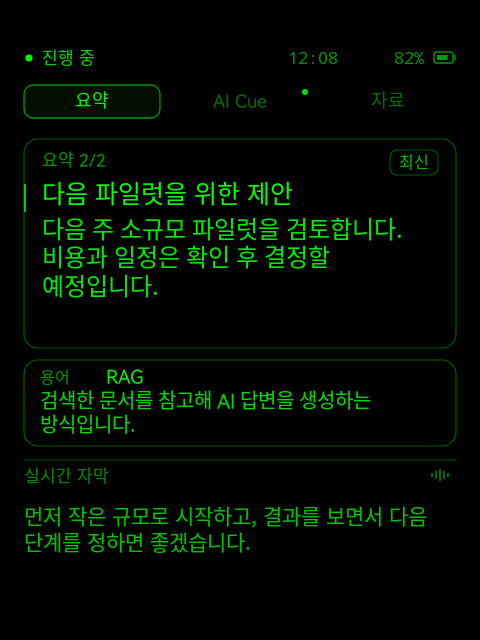 | 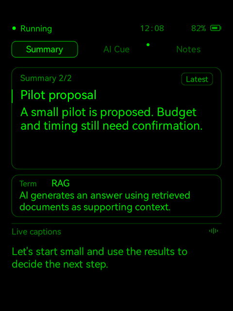 |
| 用語の詳細 | 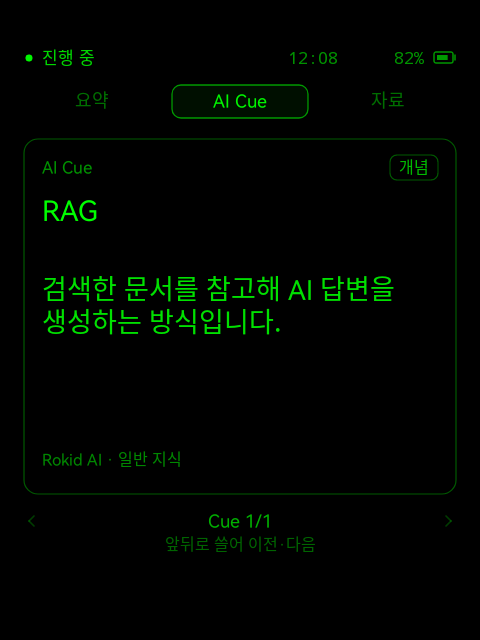 | 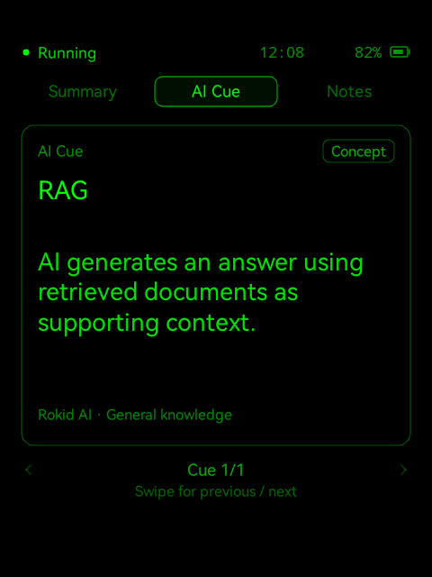 |
| 自動表示オフ | 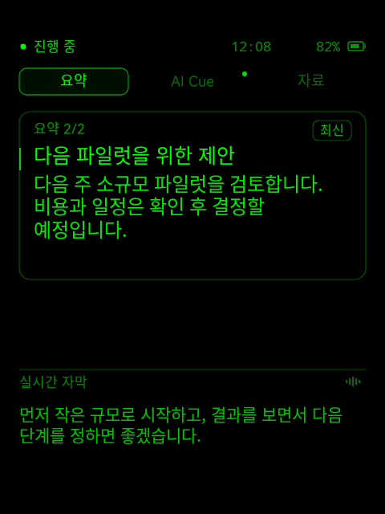 | 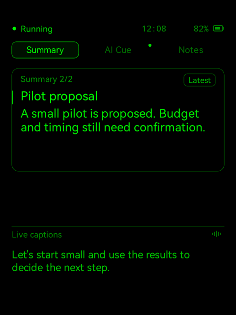 |
| 要約と字幕 | 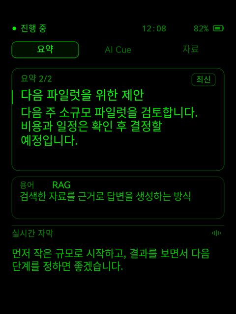 | 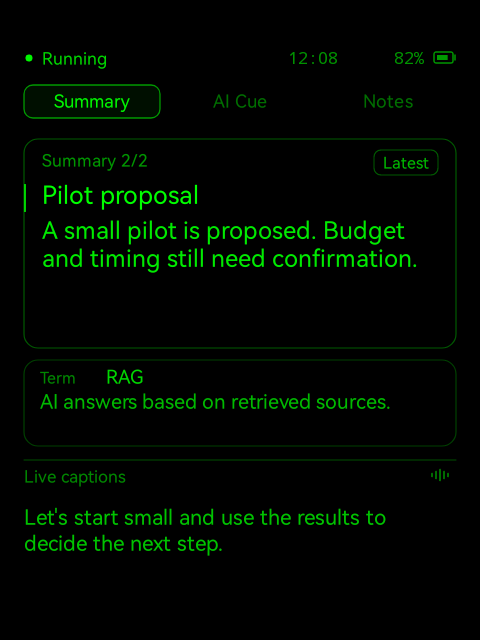 |
| 開始待ち | 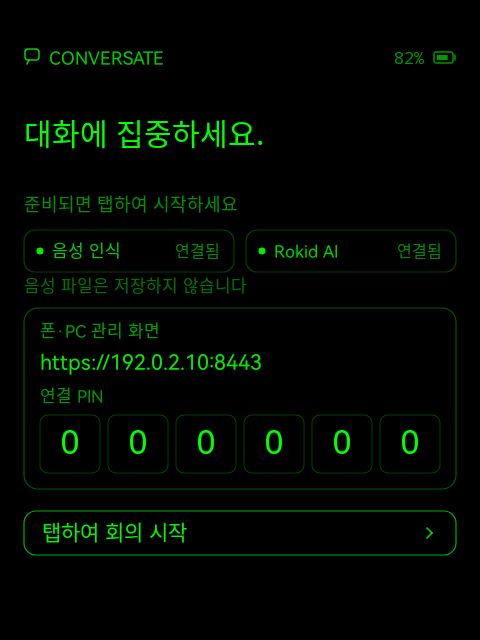 | 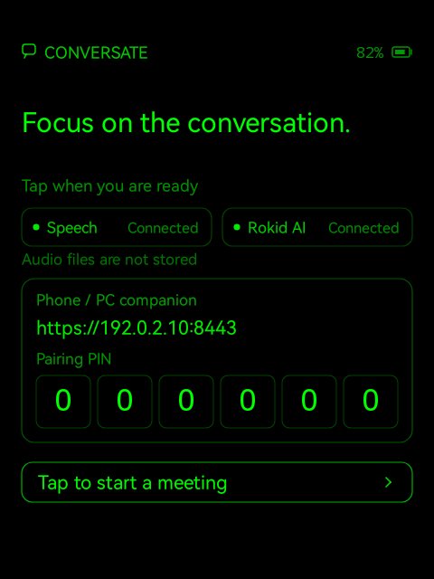 |
| 事前資料 | 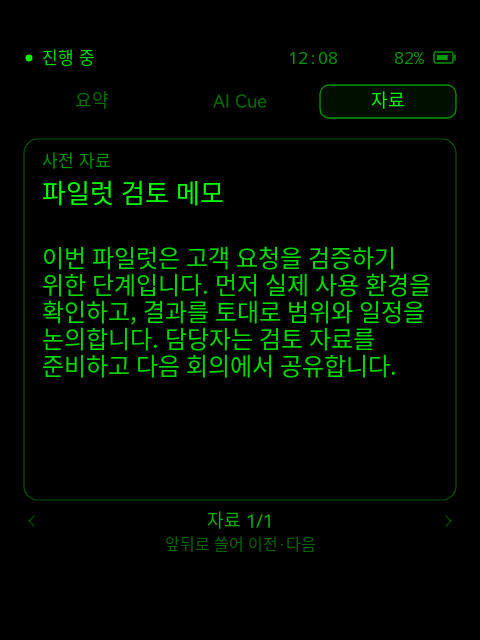 | 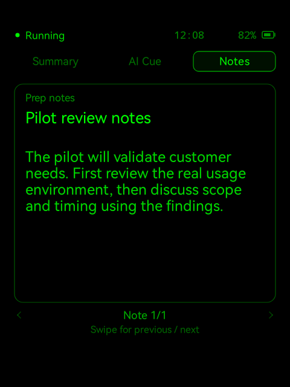 |

全42画面は[韓国語README](README.md)と[英語README](README.en.md)のギャラリーに掲載しています。[画面設計と描画検証](docs/LENS-DESIGN.md)

## 関連ドキュメント

リンク先には韓国語・英語の文書も含まれます。

- [詳しいインストール手順・英語](docs/INSTALL.en.md)
- [詳しい使い方・韓国語](docs/USAGE.md)
- [用語Cueの調査と実装](docs/CONCEPT-CUES.md)
- [実行・終了とバックグラウンド動作](docs/POWER.md)
- [実装と検証の記録](docs/BUILD-STATUS.md)
- [言語の仕様](docs/LANGUAGES.md)
- [APK単独導入の制限](docs/SETUP-LIMITS.md)
- [STT接続の調査](docs/ROKID-STT.md)
- [AIヘルパーの導入と通信](tools/rokid-ai/README.md)

**会話に集中しながら、必要な情報をひと目で。Rokid標準STTとRokid AIで、その体験を実現するプロジェクトです。**
