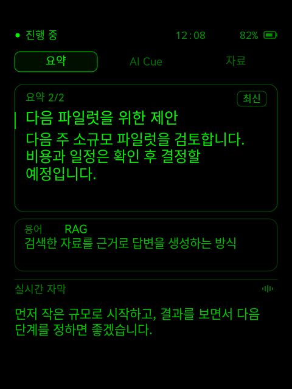
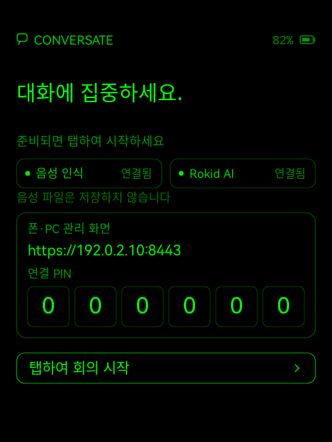
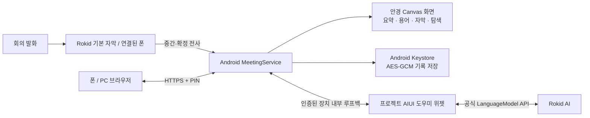

# Rokid Conversate

### Even Realities G2 Conversate의 대화 보조 경험을, 이제 Rokid에서도.

[한국어](README.md) · [English](README.en.md)

**말을 받아 적는 안경에서, 대화를 이해하고 기억하도록 돕는 안경으로.**

Rokid Conversate는 Rokid Glasses의 기본 음성 인식과 Rokid AI를 연결한 회의 보조 앱입니다. Even Realities G2의 **Conversate가 보여 준 ‘대화 중 필요한 정보를 눈앞에서 확인하는 경험’**에서 출발해, 발화 묶음 요약·전문 용어 풀이·스와이프 탐색·회의 전 자료 준비·회의 후 기록까지 Rokid에서 이어지도록 구현했습니다.

핵심은 자막을 계속 읽게 만드는 것이 아닙니다. **대화에 집중하면서 상단의 짧은 요약을 확인하고, 놓친 흐름은 안경테를 쓸어 다시 읽는 것**입니다. 실시간 전사는 필요할 때 켜고 끌 수 있습니다.

> 현재 버전: **0.3.1-lens** · Android 네이티브 앱 + 로컬 웹 관리 화면 + Rokid AIUI 도우미 위젯. 독립적인 비공식 프로젝트이며 Even Realities 또는 Rokid의 공식 제품·제휴 앱은 아닙니다. Conversate의 핵심 사용 경험을 Rokid에 재구현한 것으로, 원제품과의 모든 기능·성능 동등성을 주장하지 않습니다.

## 외부 AI API 키 없이, 로컬 앱과 Rokid AI로

**OpenAI·Claude 등 별도 외부 AI API를 직접 호출하지 않습니다. API 키 입력도, 별도 개발자 서버 구축도 필요하지 않습니다.** 안경 내부 앱·암호화 기록·로컬 웹 관리 화면을 바탕으로, 음성 인식과 생성은 Rokid 기본 STT와 Rokid AI를 사용합니다.

여기서 로컬은 앱·기록·관리 화면·도우미 연결을 뜻합니다. 도우미는 Rokid의 공식 호스트 기능을 사용하므로 **API 호출이 전혀 없거나 AI까지 완전 오프라인이라는 뜻은 아닙니다.** Rokid의 폰·클라우드 연결과 서비스 정책은 그대로 적용될 수 있습니다.

> **현재는 개발자 설치 프리뷰입니다. APK 단독으로 AI 도우미를 최초 설치할 수는 없습니다.** Windows 설치 ZIP도 ADB·Node.js 준비가 필요한 개발 배포 경로입니다. [APK 단독 설치가 막히는 이유와 공식 배포 대안](docs/SETUP-LIMITS.md)을 확인하세요.

## 빌드 없이 바로 설치하기

**[v0.3.1 프리뷰 다운로드](https://github.com/hardline7/Rokid-Conversate/releases/tag/v0.3.1)** · [한국어 설치 안내](docs/INSTALL.ko.md) · [English setup guide](docs/INSTALL.en.md)

| 다운로드 | 용도 |
|---|---|
| [Windows Setup ZIP](https://github.com/hardline7/Rokid-Conversate/releases/download/v0.3.1/Rokid-Conversate-v0.3.1-Windows-Setup.zip) | **권장:** APK + AI 도우미 + 자동 설치 스크립트 + 한영 안내 |
| [APK](https://github.com/hardline7/Rokid-Conversate/releases/download/v0.3.1/Rokid-Conversate-v0.3.1.apk) | APK만 직접 설치할 때. AI 도우미는 별도 설치 필요 |
| [SHA256SUMS.txt](https://github.com/hardline7/Rokid-Conversate/releases/download/v0.3.1/SHA256SUMS.txt) | 다운로드 파일 검증 |

Windows에서 **ADB와 Node.js 20+**를 준비하고 ZIP을 완전히 푼 뒤 해당 폴더에서 실행합니다. Android Studio·JDK·앱 빌드는 필요 없습니다.

```powershell
powershell -NoProfile -ExecutionPolicy Bypass -File .\Install-Conversate.ps1
```

설치기는 APK와 Rokid AI 위젯을 함께 설치합니다. 안경에서 USB 디버깅을 승인하고 폰의 Rokid 연결을 유지하세요. 업데이트 전에는 회의를 종료해야 합니다. 현재 배포물은 도우미 설치 방식에 필요한 **개발/debug 서명 프리뷰 APK**이며, 다른 서명으로 빌드된 앱과의 교체·업데이트는 [서명 안내](docs/INSTALL.ko.md#업데이트와-서명)를 확인하세요.

## Codex·Claude Code에게 설치를 맡기기

PC에서 터미널 명령을 실행할 수 있는 **Codex, Claude Code 같은 AI 코딩 도구**에 아래 내용을 통째로 복사해 넣으세요. 안경은 USB 데이터 케이블로 연결하고 폰의 Rokid 앱과 페어링해 두면 됩니다. USB 디버깅 승인처럼 사람이 해야 하는 단계는 AI의 안내에 따라 진행하세요.

이 프롬프트는 AI가 PC의 ADB·Node.js 준비부터 설치·확인까지 돕도록 요청합니다. **APK만으로 설치되는 기능을 새로 만드는 것은 아니며**, 설치를 돕는 AI와 회의 앱이 사용하는 Rokid AI는 별개입니다.

```text
내 PC에 USB로 연결한 Rokid 안경에 Rokid Conversate와 AI 도우미를 설치해 줘.
설치 방법만 설명하고 끝내지 말고, 실행 가능한 작업은 직접 진행해 줘.

프로젝트: https://github.com/hardline7/Rokid-Conversate
설치할 배포본: https://github.com/hardline7/Rokid-Conversate/releases/tag/v0.3.1
설치 안내: 저장소의 docs/INSTALL.ko.md
설치 한계: 저장소의 docs/SETUP-LIMITS.md

1. 먼저 운영체제와 현재 PC 환경, ADB, Node.js/npm, 연결된 장치를 확인해.
   기본 경로는 공개 릴리스 APK를 설치하는 방식이야. 앱을 직접 빌드하거나
   Android Studio·전체 Android SDK·JDK를 불필요하게 설치하지 마.
2. Windows라면 ADB Platform-Tools와 Node.js 20+/npm이 없을 때 공식 배포처에서
   필요한 도구만 준비해 줘. 다른 OS라면 설치 가이드의 검증 범위를 확인하고,
   Windows 전용 스크립트가 그대로 동작한다고 가정하지 마.
3. 공개 v0.3.1 릴리스의 Rokid-Conversate-v0.3.1-Windows-Setup.zip과
   SHA256SUMS.txt를 받아
   ZIP의 SHA-256을 확인한 뒤 별도의 작업 폴더에 완전히 풀어.
   GitHub의 자동 생성 Source code ZIP을 설치 패키지로 착각하지 마.
4. adb devices -l로 실제 안경을 식별해. 여러 장치가 있으면 아무 장치나 고르지 말고
   대상 안경을 확인해. USB 디버깅 승인이 필요하면 내가 할 동작만 짧게 알려 줘.
5. 진행 중인 회의는 중단하거나 강제 종료하지 마. 기존 회의가 끝난 것을 확인한 뒤
   설치해. 앱 삭제, 데이터 초기화, 루팅, 시스템 서명·권한 제한 우회는 하지 마.
   서명 불일치가 나오면 중단하고 기록 내보내기와 해결 방법을 설명해.
6. Windows에서는 압축을 푼 폴더의 설치기와 안내를 확인한 뒤 실행해.
   다른 OS에서는 이 Windows 명령을 무작정 실행하지 말고, 해당 OS의 공식 CLI
   절차와 지원 범위를 확인한 뒤 진행해. Windows 명령은 다음과 같아:
   powershell -NoProfile -ExecutionPolicy Bypass -File .\Install-Conversate.ps1 -Serial <확인한-장치-ID>
   이 절차는 APK와 Rokid AI 위젯을 설치하고 개발자 모드를 활성화해.
7. 회의 앱에 OpenAI·Claude 등의 외부 AI 공급자나 API 키를 추가하지 마.
   공개 릴리스 다운로드에 GitHub 토큰도 필요 없어. Rokid 계정 자격증명이나
   앱의 로컬 연결 비밀값, 회의 전사를 출력·업로드하지 말고 제공된 설치기를 사용해.
8. 설치 후 앱 실행, 도우미 연결, 실제 AI 연결 상태를 확인해.
   테스트가 필요하면 회의가 없는 상태에서 앱의 합성 질문 연결 테스트를 사용해.
   실제 회의 녹취는 자동으로 시작하지 마. 안경 착용이나 화면 승인이 필요하면 알려 줘.
9. 마지막으로 설치 버전, 성공한 확인 항목과 남은 문제를 보고해.
   같은 네트워크에서 안경에 표시된 HTTPS 주소와 현재 PIN으로 웹에 연결하는 법,
   다음에 앱을 여는 방법도 알려 줘. 명령 성공만으로 AI까지 연결됐다고 단정하지 마.

이 앱은 로컬 기록과 Rokid 기본 STT·Rokid AI를 사용해.
별도 외부 AI API 키는 없지만 Rokid 자체 폰·서비스 통신은 필요할 수 있어.
```

이 설치 프롬프트는 현재 공개된 **v0.3.1 프리뷰**를 대상으로 합니다. 최신 main 소스를 임의로 빌드해 배포 APK 대신 설치하지 않도록 버전을 고정했습니다.

## 한눈에 보는 기능

| 기능 | 실제로 할 수 있는 일 |
|---|---|
| **발화 묶음 요약** | 말이 한 묶음 끝나면 Rokid AI가 핵심을 짧게 정리해 안경 상단에 표시합니다. |
| **요약 스와이프 탐색** | 안경테를 쓸어 이전·다음 요약을 봅니다. 과거 요약을 읽는 동안 새 카드가 와도 읽던 화면을 유지합니다. |
| **전문 용어 풀이** | 발화에 등장한 전문 용어를 짧게 설명합니다. 불명확한 용어와 모호한 설명은 생략하도록 검증합니다. |
| **선택형 실시간 자막** | 자막 표시만 끌 수 있습니다. 자막을 꺼도 확정 전사 저장과 AI 요약 입력은 유지됩니다. |
| **AI Cue** | 답변, 인물 정보, 개념, 제안을 제공합니다. 답변·인물 정보는 선택한 자료의 출처와 원문 인용을 확인합니다. |
| **Prep Notes** | 회의 전 배경·수치·질문을 작성하고 TXT·Markdown·텍스트 PDF를 가져옵니다. |
| **로컬 웹 관리 화면** | 같은 네트워크의 폰·PC 브라우저에서 자료, 회의 조작, 전체 전사, 설정을 관리합니다. 별도 웹 서버를 구축하지 않습니다. |
| **회의 기록과 리캡** | 발화 묶음, 전체 요약, Cue, 전체 전사를 보관하고 검색·Markdown 내보내기를 지원합니다. |
| **Rokid 언어 연동** | 안경·웹·새 AI 출력이 안경의 현재 시스템 언어를 따릅니다. |
| **암호화 저장** | 회의 전사·자료·설정은 Android Keystore 기반 AES-GCM으로 안경 내부에 보관합니다. |

## 새 안경 화면

요약을 중심으로 얇은 라인, 작은 상태바와 탭, 별도 용어 영역, 밝기를 낮춘 하단 자막을 배치했습니다. 대기 화면에는 연결 상태와 큰 PIN을 표시합니다. 아래는 **예시 데이터와 기기 폰트로 실제 네이티브 Canvas를 렌더링한 이미지**이며, 개인 회의나 실제 PIN이 아닙니다.

| 요약 · 용어 · 자막 | 회의 준비 · 연결 |
|---|---|
|  |  |

[디자인과 렌더링 검증 방법](docs/LENS-DESIGN.md)

## 이 앱을 만든 이유

실시간 전사만 길게 쌓이면 사용자는 회의 중에도 계속 글을 읽어야 합니다. 우리가 재현하고 싶었던 Conversate의 매력은 **‘기록’과 ‘지금 도움이 되는 정보’를 연결하는 경험**이었습니다.

그래서 이 프로젝트는 다음 흐름을 하나로 묶었습니다.

1. **회의 전:** 필요한 자료를 준비하고 이번 회의에 사용할 문서를 선택합니다.
2. **회의 중:** 대화는 계속 듣고, 짧은 요약과 용어 풀이만 눈앞에서 확인합니다.
3. **놓쳤을 때:** 스와이프로 이전 요약을 바로 다시 봅니다.
4. **회의 후:** 전체 전사와 요약, Cue를 검토하고 Markdown으로 가져갑니다.

**Rokid의 기존 STT·AI를 그대로 활용하면서 이 흐름을 실제 안경 앱으로 연결했다는 것**이 이 프로젝트의 가장 큰 성과입니다.

## 회의 중에는 어떻게 동작하나요?

### 1. 발화가 모이면 상단에 요약합니다

확정된 발화를 기준으로 다음 조건 중 먼저 충족되는 시점에 묶음 요약을 요청합니다.

- 마지막 인식 발화 이후 약 **3초**가 지났을 때
- 묶음의 첫 확정 발화 이후 약 **25초**가 지났을 때
- 아직 요약하지 않은 확정 발화가 **6개** 모였을 때

긴 입력은 요청당 최대 8개 발화, 약 2,400자를 기준으로 나눕니다. 하나의 발화 자체가 이보다 길면 그 발화는 통째로 전달될 수 있습니다. 생성에 실패하면 해당 묶음을 처리했다고 넘기지 않고 재시도합니다. 종료 직전 남은 발화도 별도로 처리합니다.

이 시간은 **요약 요청을 시작하는 기준**입니다. STT 확정 시간, 도우미 대기, 네트워크와 Rokid AI 생성 시간이 추가됩니다. 의미 단위를 완벽하게 판별하는 화자 분리 기능은 아닙니다.

### 2. 요약은 유지하고, 읽는 위치는 존중합니다

기본 화면 상단에는 최근 요약이 유지되고, 자막을 켜면 하단에 최근 발화가 표시됩니다. 이전 요약으로 이동하면 해당 카드에 머무릅니다. 가장 최신 카드로 돌아오면 이후 새 요약을 자동으로 따라갑니다.

### 3. 용어와 답변에 근거를 요구합니다

용어 표기는 실제 발화에 있어야 하며, 신뢰도와 길이 조건을 통과해야 합니다. 자료 기반 Answers·Bios에는 실제 선택 자료의 ID와 정확한 인용이 필요하고, 숫자도 인용문과 대조합니다.

이 검증은 잘못된 정보를 줄이기 위한 장치입니다. 모델이 스스로 제시한 신뢰도가 정확성을 증명하지는 않습니다. 특히 약어·이름을 STT가 잘못 인식하면 올바른 풀이가 생략되거나 부정확해질 수 있습니다.

## 어떤 구조인가요?



| 구성 요소 | 역할 |
|---|---|
| `MeetingService` | 인식 소유권, 회의 생명주기, 마지막 발화 저장 대기, AI 작업과 웹 API를 관리합니다. |
| `RokidSttClient` | 기본 자막 서비스의 비공개 Binder/GATT 경로와 연결합니다. |
| `LiveSummaryPolicy` | 미처리 발화를 묶고 요약·용어 응답을 검증하며 탐색 규칙을 제공합니다. |
| `MeetingLensView` | 실제 장치의 480×640 화면에 맞춰 안경용 정보를 그립니다. |
| `RokidRelayAi` + AIUI 위젯 | 일반 APK에서 직접 사용할 수 없는 호스트 AI 기능을 프로젝트 도우미를 통해 사용합니다. |
| `MeetingStore` + `Vault` | 암호화 저장, 발화 정정·중복 처리, 중단 기록 복구와 내보내기를 담당합니다. |
| `CompanionServer` | 안경에서 HTTPS 관리 화면과 인증된 API를 제공합니다. |
| `L10n` + 웹 `i18n.js` | 안경 언어 감지, 화면 번역 캐시, 원문과 UI 문구 분리를 담당합니다. |

STT 연결은 **비공개 인터페이스**를 사용합니다. AI 도우미는 Rokid의 공식 AIUI `LanguageModel` 기능을 사용합니다. 루팅, 시스템 서명 변경, Rokid 계정 자격증명 추출로 AI 제한을 우회하는 구조가 아닙니다.

## 왜 이 방식이 좋은가요?

- **Rokid 사용자에게 익숙한 경로:** 기본 자막과 연결된 폰의 기존 음성 인식 경로를 사용합니다. 마이크 수집 파이프라인을 별도로 구축하지 않습니다.
- **별도 LLM API 키 불필요:** Claude·OpenAI 등의 외부 생성 AI 공급자를 추가하지 않습니다. Rokid AI 계정·연결을 활용합니다. 실제 서비스 이용 가능 여부와 비용·정책은 Rokid에 따릅니다.
- **회의 중 읽기 부담 감소:** 전사 전체를 계속 보는 대신 짧은 요약과 필요한 정보를 확인합니다.
- **운영할 웹 서버가 없음:** 웹 관리 화면을 안경이 직접 제공합니다. 폰·PC에는 브라우저만 있으면 됩니다.
- **자료와 대화를 연결:** 사전 자료를 회의별로 스냅샷 저장합니다. 전체 회의 요약은 실제 전사만 사용해, 참고 자료가 회의의 확정 결론으로 섞이는 일을 줄입니다.
- **AI가 잠깐 끊겨도 기록은 계속:** 인식 경로가 살아 있는 동안 자막과 확정 발화 저장은 AI 응답과 독립적으로 동작합니다. STT 자체에는 Rokid 폰 연결이 필요합니다.
- **다른 언어 사용자도 고려:** 브라우저 언어가 아닌 안경의 실제 언어 설정을 기준으로 UI와 AI 출력을 맞춥니다.

## 직접 소스에서 빌드할 때의 준비

현재 실제 검증 장치는 **Rokid RG_glasses, Android 12 계열/API 32**입니다. 모든 Rokid 모델·펌웨어에서 검증된 범용 SDK 앱은 아닙니다.

준비물:

- 지원 경로가 동작하는 Rokid Glasses와 연결된 폰의 Rokid 앱
- Rokid 기본 자막과 AI를 사용할 수 있는 계정·네트워크
- USB 연결 및 USB 디버깅 승인이 된 PC
- **JDK 17 이상** — 이 프로젝트에서는 JDK 21로 검증했습니다.
- Android SDK **Platform 35**, **Build Tools 35.0.0**, **platform-tools/ADB**
- AI 도우미 설치용 Node.js/npm 및 Windows PowerShell
- 웹 관리용으로 안경에 접근할 수 있는 같은 네트워크의 브라우저

SDK 라이선스는 Android SDK Manager에서 승인해 주세요. 프로젝트의 Gradle Wrapper가 Gradle 8.11.1을 준비합니다.

## 개발자용: 소스에서 빌드하고 설치하기

### 1. 소스를 받습니다

```powershell
git clone https://github.com/hardline7/Rokid-Conversate.git
cd Rokid-Conversate
```

공개 저장소이므로 인증 없이 소스를 받을 수 있습니다. 변경 사항을 푸시하려면 GitHub 쓰기 권한이 필요합니다. 토큰을 소스나 remote URL에 넣어 저장하지 마세요.

### 2. Android SDK 위치를 지정합니다

루트에 `local.properties`를 만들고 본인 SDK 경로를 적습니다. 이 파일은 Git에서 제외됩니다.

```properties
sdk.dir=C:/Users/YOUR_NAME/AppData/Local/Android/Sdk
```

`adb`가 터미널에서 실행되는지도 확인합니다.

```powershell
adb devices -l
```

안경에서 USB 디버깅 승인을 허용하고 상태가 `device`인지 확인합니다. 장치가 여러 개면 아래 ADB 명령에 `-s <장치-ID>`를 넣으세요.

### 3. 앱을 빌드하고 설치합니다

```powershell
.\gradlew.bat testDebugUnitTest lintDebug assembleDebug
adb install -r app/build/outputs/apk/debug/app-debug.apk
adb shell am start -W -n app.conversate.glass/.meeting.MeetingActivity
```

macOS/Linux에서는 `./gradlew`를 사용할 수 있습니다. 도우미 설치 스크립트의 검증 환경은 Windows입니다. 현재 빌드·설치 흐름은 개발용 debug APK를 사용합니다.

### 4. Rokid AI 도우미를 설치합니다

회의를 시작하지 않은 상태에서 실행하세요.

```powershell
.\tools\rokid-ai\Install-Helper.ps1
# 장치가 여러 개라면:
.\tools\rokid-ai\Install-Helper.ps1 -Serial <장치-ID>
```

스크립트는 연결된 장치가 하나면 자동 선택하고, 버전이 고정된 공식 AIX CLI를 준비해 프로젝트 위젯을 설치·실행합니다. 개발자 모드를 켜며, 위젯이 붙도록 홈 화면을 잠시 열었다가 회의 화면으로 돌아옵니다. 도우미가 사용하는 비밀값은 **이 앱이 생성한 로컬 연결용 값**이며 Rokid 계정 토큰이 아닙니다.

안경에서 **Rokid AI 연결됨**이 표시되면 준비가 된 것입니다. 기본 설치는 Widget 방식입니다. `-Page`는 진단용 카드이므로 평소 회의에 사용하지 않습니다.

### 5. 폰·PC 브라우저를 연결합니다

안경에 나온 `https://<안경-IP>:8443` 주소를 엽니다. 안경이 자체 생성한 인증서이므로 처음에는 브라우저 경고가 나올 수 있습니다. 본인 안경의 주소인지 확인하고 해당 장치 접속을 허용한 뒤, **현재 안경에 표시된 6자리 PIN**을 입력하세요.

PIN은 서비스가 다시 시작되면 바뀝니다. README에 고정 PIN은 제공하지 않습니다.

## 매일 사용하는 순서

1. **사전 자료:** 배경·수치·질문을 적거나 파일을 올리고 사용할 자료를 선택합니다.
2. **연결 확인:** 안경의 STT·Rokid AI 연결 상태를 확인합니다. 설정에서 AI 테스트를 실행할 수도 있습니다.
3. **참석자 알림:** 대화 기록과 Rokid AI 사용을 알리고 시작 확인을 합니다.
4. **회의 시작:** 대기 화면에서 탭 → 확인 화면에서 탭, 또는 웹에서 시작합니다.
5. **대화:** 상단 요약을 확인하고 필요할 때 이전 요약을 쓸어 봅니다.
6. **회의 종료:** 종료 확인 또는 웹 종료 버튼을 사용합니다. 앱은 마지막 확정 발화를 기다린 뒤 기록을 닫습니다.
7. **정리:** 발화 묶음 / Summary / Cue List / Transcription을 검토하고 Markdown으로 내보냅니다.

### 안경 조작표

| 조작 | 동작 |
|---|---|
| 대기 중 탭 | 회의 시작 확인 |
| 시작 확인에서 탭 | 알림·동의 확인 후 시작 |
| 회의 중 탭 | 요약 → Cue → 자료 화면 전환 |
| 앞으로·뒤로 스와이프 | 현재 화면의 요약·Cue·자료에서 이전·다음 항목 |
| 두 번 탭 | 현재 Cue 닫기, 확인 취소 또는 종료 확인 — 상태에 따라 동작 |
| 일시정지 상태에서 탭 | 같은 회의 재개 |

화면이 꺼지거나 앱이 전면에서 벗어나면 일시정지합니다. 복귀만으로 자동 녹취를 시작하지 않습니다. 10분 동안 인식 발화가 없으면 자동 종료합니다.

## 자료와 기록의 범위

- 입력: UTF-8 TXT, Markdown, 텍스트를 포함한 PDF. **스캔 PDF OCR은 포함하지 않습니다.**
- 파일 최대 8MB, PDF 최대 200페이지, 자료당 최대 60,000자
- Prep Notes 최대 100개, 선택 자료의 합 최대 100,000자
- 파일 원본 대신 추출 텍스트만 보관하며 PDF에는 `[p.1]` 형태의 페이지 표기를 붙입니다.
- 웹은 렌즈의 최근 발화 미리보기와 별도로 **전체 전사**를 읽습니다. 위쪽을 읽을 때 새 발화 때문에 맨 아래로 끌려가지 않으며, 처음/최신 이동 버튼도 제공합니다.
- 프로세스 중단 후 진행 중이던 회의는 중단 기록으로 복구합니다. 앱 삭제나 키 손실 후 암호화 기록 복구를 보장하는 백업 서비스는 포함하지 않습니다.

## 언어는 어떻게 따라가나요?

한국어·영어 UI는 내장되어 즉시 표시됩니다. 다른 언어의 UI 문구는 연결된 Rokid AI가 번역하고 안경에 캐시합니다. 준비 중이거나 AI가 없으면 영어를 표시합니다. 설정에서 감지된 언어와 준비 상태를 볼 수 있습니다.

요약·제목·Cue·용어 정의는 현재 안경 언어로 요청합니다. **기존 전사, 사용자 자료, 과거 생성 결과, 출처 인용은 원문을 유지합니다.** 실제 음성 인식 언어는 Rokid 기본 자막/폰 앱 설정을 따릅니다. 모든 언어의 품질을 사람이 검수한 것은 아닙니다. 자세한 동작은 [LANGUAGES.md](docs/LANGUAGES.md)를 참고하세요.

## 데이터는 어디에 있나요?

회의 기록·자료·설정은 안경 내부에 암호화해 저장합니다. 앱 자체는 마이크 음성 파일을 저장하지 않습니다. HTTPS 관리 화면은 PIN 인증, 세션 쿠키, Origin 검사와 업로드 제한을 사용합니다. AI 도우미 연결은 인증된 `127.0.0.1` 루프백으로 제한합니다.

**로컬 저장이 곧 완전한 오프라인 처리를 뜻하지는 않습니다.** STT·회의 AI에는 연결된 Rokid 폰/서비스가 사용되고, 선택 자료와 전사는 해당 AI 작업에 전달될 수 있습니다. Rokid의 서버 처리·계정 한도·보관 정책은 이 앱이 통제하지 않습니다. UI 번역 작업에는 앱의 정적 문구만 전달합니다.

이 저장소에는 개인 회의 기록, 런타임 토큰, 장치 캡처, 추출한 시스템 APK·라이브러리, 로컬 SDK를 포함하지 않습니다.

## 검증 상태

현재 **34개 JVM 테스트와 Android lint·빌드**를 통과했습니다. v0.3.1은 언어 처리 보완과 새 렌즈 디자인을 포함합니다. 실제 장치의 폰트로 한국어·영어 36가지 상태를 렌더링하고 단색·안전 영역을 검사했습니다. 실제 장치에서 STT 수신, 시작·일시정지·재개·종료, AI 응답, 상단 요약 표시·저장, HTTPS 관리와 기존 기록 보존을 확인했습니다. 웹은 PC·모바일에서 전체 전사 스크롤, 영어 UI와 일본어 문구 갱신을 검사했습니다. 실제 Rokid AI의 일본어·스페인어 번역 응답도 확인했습니다.

다음 항목까지 완료한 것은 아닙니다.

- 모든 Rokid 모델·펌웨어 호환성
- 모든 언어의 실제 기기 전환 시험과 번역 품질 검수
- 물리 스와이프의 장시간 사용성 검증
- 60분 배터리·안정성 시험과 실제 회의 3건 완주
- 모든 입력에서의 요약 지연·정확도 보장

자세한 근거와 한계는 [BUILD-STATUS.md](docs/BUILD-STATUS.md)에 기록했습니다. 비공개 STT 인터페이스는 펌웨어 업데이트로 달라질 수 있습니다.

## 개발 및 테스트

```powershell
# Android 단위 테스트 + lint + APK
.\gradlew.bat testDebugUnitTest lintDebug assembleDebug

# 웹 테스트 의존성 및 Chromium 준비
npm ci
npx playwright install chromium
npm run test:web
npm run test:web:mobile
```

기존 Chrome으로 실행하려면 PowerShell에서 `$env:PLAYWRIGHT_CHANNEL='chrome'`를 지정할 수 있습니다. 실제 장치 테스트 도구 `tools/meeting_smoke.py`는 일부 단계에서 회의를 시작·중지하거나 테스트 자료를 변경하므로, 실제 회의 중에는 실행하지 마세요.

```text
app/src/main/java/app/conversate/glass/
  meeting/                 회의 서비스, 렌즈 UI, 저장소, HTTPS, AI, 언어 처리
  stt/                     Rokid STT 클라이언트와 전사 파서
  probe/                   초기 화면·입력 측정 도구
app/src/main/assets/companion/  브라우저 관리 화면
app/src/test/              JVM 회귀 테스트
tools/rokid-ai/helper/     프로젝트 AIUI 도우미 소스
tools/rokid-ai/Install-Helper.ps1
tools/test_*.cjs           브라우저 회귀 테스트
docs/                     사용법, 설계, 검증 기록
```

## 문제가 생기면

| 증상 | 먼저 확인할 것 |
|---|---|
| 관리 화면이 안 열림 | 안경에 표시된 현재 IP·포트, 같은 네트워크, 안경 전원과 앱 실행 상태 |
| PIN이 맞지 않음 | 서비스 재시작 후 PIN이 바뀌었는지 확인 |
| 자막이 안 들어옴 | 폰의 Rokid 연결과 기본 자막 기능·인식 언어 확인 |
| AI 연결 대기 | 홈 화면을 잠시 열고 복귀해 위젯을 붙이거나, 회의 종료 후 도우미 설치 스크립트 실행 |
| 요약·용어가 늦거나 없음 | AI 연결·네트워크, 확정 발화 유무, 요약/Cue 설정 확인 |
| 다른 언어에서 영어가 나옴 | UI 번역 준비 상태와 Rokid AI 연결 확인. 캐시 전에는 영어가 정상 대체 언어임 |
| 업로드 PDF가 비어 있음 | 텍스트 PDF인지 확인. 스캔 이미지에는 별도 OCR이 필요함 |

## 더 읽어보기

- [상세 사용법](docs/USAGE.md)
- [현재 구현·검증 기록](docs/BUILD-STATUS.md)
- [제품 목표](docs/PRD.md)
- [STT 연결 설계와 조사 기록](docs/ROKID-STT.md)
- [AI 도우미 설치와 프로토콜](tools/rokid-ai/README.md)
- [언어 동작 설명 — English](docs/LANGUAGES.md)
- [Rokid 공식 LanguageModel 문서](https://open.rokid.com/aiui/api/ai/language-model?lang=en-US&version=0.19.0)

**Conversate에서 영감을 받은 대화 보조 경험을 Rokid에서도 실제로 사용할 수 있게 만든 프로젝트입니다. 다음 회의에서는 기록을 따라 읽기보다, 대화에 집중해 보세요.**
