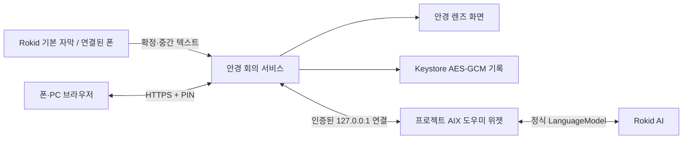

# 구현 및 검증 기록

## v0.3.0 APK 배포 준비 (2026-11-17)

GitHub 릴리스용 개발 서명 APK, APK와 AI 위젯 설치를 묶은 Windows Setup ZIP, SHA256SUMS를 패키징한다. 소스 빌드 없이 ADB·Node.js 20+/npm만으로 설치할 수 있도록 한영 가이드와 설치기를 추가했다. 런타임 토큰·개인 키·장치 데이터·CLI 캐시는 패키지에 넣지 않는다. 도우미 설치가 adb run-as를 사용하므로 현재 배포 APK는 debuggable 개발 빌드다.

설치기 모의 테스트에서 APK와 도우미 연결, 진행 중 인식 차단, 미승인 장치 차단, APK 체크섬 불일치 차단을 확인했다. 별도 새 장치에서 설치기를 처음부터 실제 실행한 것은 아니므로, 이 배포는 프리뷰로 표시한다. 릴리스 노트와 설치 가이드는 docs/releases/v0.3.0.md 및 INSTALL.ko.md/INSTALL.en.md에 있다.

## 0.3.0 Rokid 기기 언어 연동 (2026-11-17)

versionCode 5 / `0.3.0-device-language`를 연결된 안경에 설치했다. 현재 활성 시스템 언어 `ko-KR`을 Android Configuration에서 읽는다. 공장 기본값 `ro.product.locale=zh-CN`은 사용하지 않는다.

- 앱 소유 화면/오류/웹 문구를 공통 카탈로그로 분리했다. 한국어와 영어는 내장되어 즉시 표시한다. 다른 언어는 Rokid AI가 UI 문구만 20개씩 번역해 안경 내부에 캐시한다. 준비 중·연결 불가 시 영어로 표시하고 설정에 준비 상태를 표시한다. 한 번 번역된 언어는 재사용한다. 번역 품질은 Rokid 모델에 의존한다.
- 웹도 브라우저 언어 대신 안경 언어를 따른다. 로그인 전 화면, 설정, 버튼, 오류, 날짜와 접근성 레이블도 포함한다. 언어 팩 도착 시 정적 레이블만 갱신하며 전사/사용자 자료/제목 원문을 번역 대상으로 순회하지 않는다.
- 생성 요약·리캡·제목·Cue·용어 정의는 기기 언어로 요청한다. JSON 키·Cue 타입·출처 원문·발화에 나온 용어 표기는 보존한다. 처리 중 기기 언어가 바뀐 AI 결과는 폐기해 재시도한다.
- 언어 변경 시 Activity가 재시작되며 녹취를 일시정지하는 문제를 피하도록 locale/layoutDirection 변경을 처리한다. STT 시작 명령은 언어를 강제하지 않으며, 실제 인식 언어는 Rokid 기본 자막/연결된 폰 설정을 그대로 따른다.
- UI 번역 결과는 JSON 문자열/누락 키/길이/자리표시자를 검증하며 textContent로 표시한다. PIN 숫자는 Locale.US로 생성한다.

검증: 29개 JVM 테스트, lint, 빌드 통과. PC·모바일 영어 UI 및 일본어 레이블 실시간 전환, 폰트 선택 항목 번역, 원문 보존, 화면 너비를 검증했다. 전체 전사 스크롤 회귀 테스트 통과. 실기기 ko-KR 감지와 기존 회의 2개의 발화 수 보존을 확인했다. 실제 Rokid AI가 스페인어·일본어 UI 문구를 번역하고 {0}/{1} 자리표시자를 유지한 것도 확인했다. Android ICU에서 닫는 중괄호를 명시적으로 이스케이프해야 했던 초기 실행 오류를 수정하고 재설치·기동을 확인했다. 기기의 전역 언어를 실제로 변경하는 시험 및 모든 언어 번역에 대한 사람 검수는 아직 하지 않았다.

## 0.2.0 발화 묶음 요약 · 안경 적용 완료 (2026-11-17)

사용자 요청으로 USB 재연결 후 versionCode 4 / `0.2.0-live-summary`를 안경에 설치했다. 아래 0.1.1의 웹 전사 수정도 포함한다. 기존 회의의 확정 발화 71개를 업데이트 전후 비교해 보존을 확인했다. 설치 전 암호화 파일 백업은 로컬 `tools/out/meeting/pre-upgrade-encrypted.tar`에 두었다.

- 확정 발화 이후 3초 정적, 묶음 시작 후 25초, 확정 발화 6개 중 먼저 충족한 조건에서 Rokid AI에 묶음 요약을 요청한다. 연속 발화는 요청당 최대 8개 / 약 2,400자로 나눠 순차 처리하며, 실패하면 커서를 전진시키지 않고 재시도한다. 폰/AI 지연 시간은 별도다.
- 기본 렌즈 화면 상단에 제목·짧은 요약을 유지한다. 스와이프 후 이전 카드에 머물며, 가장 최신 카드로 돌아오면 새 요약을 따라간다. 탭으로 요약/Cue/자료를 전환한다.
- 전문 용어는 발화에 실제 등장한 표기, 신뢰도 0.9 이상, 짧은 정의만 수용한다. 불명확한 ASR과 모호한 풀이를 생략한다. 숫자·이름·약어를 STT가 오인하는 한계는 남아 있으며, 모델 신뢰도가 사실성을 보장하지는 않는다.
- 자막·Cue/용어 풀이·요약 설정은 별도다. 자막을 꺼도 전사 저장과 요약 입력은 유지한다. 요약 중에도 필요한 Cue를 별도 생성한다.
- 묶음 카드와 용어를 암호화 저장하고 웹의 발화 묶음 탭과 Markdown 내보내기에 포함한다. 종료 직전 남은 묶음도 처리한다. 90초 전체 요약과 최종 리캡은 별도로 유지한다.

검증: JVM 23개 테스트와 lint/assemble 성공. PC 1400px·모바일 390px 전체 전사 회귀 테스트 통과. 실제 기기 웹에서 발화 묶음 기록 조회 통과. 사용자가 말한 실제 발화로 요약 카드 2개가 렌즈에 표시·저장된 것을 확인하고 테스트 회의를 저장·종료했다. 실제 Rokid AI에 합성 RAG 문장을 보내 요약과 표준 용어 정의 생성도 확인했다. 최초 실음성에서 RAG가 ‘레그’로 오인된 모호한 풀이를 발견해 프롬프트·검증을 보완했다. 스와이프의 최신 따라가기/과거 고정 전환은 단위 테스트로 확인했으며, 사용자의 물리 스와이프 체감 확인은 남아 있다.

## 0.1.1 실시간 전체 전사 수정

초기 웹 화면은 안경 렌즈용 상태 응답(최근 15개)에서 다시 최근 8개만 표시해, 녹취는 저장되지만 사용자가 이전 내용을 스크롤해 볼 수 없는 문제가 있었다. 웹은 이제 이미 존재하는 회의 상세 API에서 진행 중인 회의의 전체 확정 발화를 읽는다. 렌즈용 상태 응답의 제한과 녹취 서비스는 변경하지 않았다.

전체 발화를 유지하며 기존 문단 DOM을 재사용하고, 위쪽을 읽는 동안 새 발화·중간 결과·앞부분 정정이 와도 읽는 위치를 보존한다. 맨 아래에 있을 때만 새 내용을 따라간다. 전체 발화 수, 처음으로/최신 내용으로 이동 버튼을 추가했다.

`node tools/test_transcript_scroll.cjs`로 300개 이상의 발화, 위쪽 읽기 위치·노드 유지, 앞부분 정정, 자동 따라가기와 이동 버튼을 검증한다. 당시에는 진행 중 회의를 중단하지 않고 APK 적용을 보류했다. 이후 회의 종료 및 USB 재연결을 확인하고 0.2.0에 포함해 설치했다.

2026-11-17 · APK `0.1.0-meeting` · 사용자 요청에 따라 STT와 생성 AI 모두 Rokid 기반

## 구현

| 범위 | 구현 상태 |
|---|---|
| 기본 STT | 화면 없는 시작/종료, 중간·확정 결과, 재개 시 발화 번호 분리 |
| 렌즈 UI | 안전 영역, 자막 3줄, Cue/자료 전환, 쓸기 탐색, 시작·종료 확인, 글자 크기 |
| 자료 관리 | HTTPS/PIN, 작성·수정·삭제·선택, TXT/MD/PDF 추출, 100개 제한, 회의별 자료 스냅샷 |
| 생성 AI | 공식 Rokid AIUI LanguageModel 도우미 위젯, 내부 인증 루프백, 외부 API 키 없음 |
| Cue | 4종, 출처/원문·숫자 검증, 우선순위, 간격·분당 제한, 페이드·히스토리, 오래된 결과 폐기 |
| 기록 | 확정 발화 즉시 암호화 저장, 정정·중복 처리, 진행 요약·최종 리캡 요청, 제목·검색·3개 탭·Markdown·삭제 |
| 설정/복구 | 자막·Cue·요약 토글, 글자 크기, 화면 이탈 일시정지, 무발화 10분 종료, 중단 세션·요약 복구 |

## 구조



일반 APK의 AIUI 서명 제한은 우회하지 않았다. 공식 AIX 개발 경로로 설치한 도우미가 호스트의 LanguageModel을 사용한다. 도우미 위젯과 일반 안경 앱이 함께 유지되는 것을 실제 기기에서 확인했다. STT는 기존 문서의 비공개 Binder/GATT 경로를 계속 사용한다.

## 실제 확인한 것

- 일반 UID `10055`에서 기본 자막 시작·종료, 한국어 중간·확정 프레임을 수신했다.
- 공식 도우미에서 `LanguageModel.availability() = available`, 한국어 질문의 실제 생성 응답을 받았다.
- 네이티브 회의 화면으로 돌아오고 테스트용 AI 카드들을 닫은 뒤에도 `source=widget` heartbeat가 15초 TTL을 넘어 여러 차례 유지됐다.
- 실제 장치의 HTTPS 서버를 ADB 포워딩과 Wi-Fi 주소에서 접속했다. 인증 전에는 401, PIN 인증 후 정상 처리됐다. 잘못된 Origin의 변경 요청은 403이었다.
- 한글 Prep Notes 작성과 한국어 TXT 업로드의 왕복 결과를 비교했다. 실제 PDF fixture에서 텍스트와 `[p.1]` 표기를 추출하고 삭제했다.
- 실제 Rokid AI에 테스트용 예산 질문과 자료를 전달하여 `Answers`, `확정 예산은 100만 원`, 정확한 출처·원문 인용을 받았고 Cue 검증을 통과했다. 이 테스트는 회의 발화를 위조하거나 회의 Cue에 저장하지 않았다.
- 실제 수신된 전사로 리캡과 제목이 생성됐다. UTF-8 손상 문제를 수정한 뒤 한국어 왕복과 리캡을 다시 검증했다. 사전 자료의 예산이 실제 대화의 결론으로 잘못 섞이는 문제를 발견해, 요약 입력에서 사전 자료와 이전 요약을 제외하고 재검증했다.
- 브라우저 UI는 데스크톱/모바일에서 로그인·동의·조작·자료·기록·설정 흐름을 확인했다. 연결 테스트 상태도 표시한다.
- 종료 요청 뒤 지연되는 확정 발화를 종료 응답 또는 제한 시간까지 받을 수 있게 보완했다. 네이티브 subtitle 오디오 파이프라인 종료 로그를 확인했다.
- 최종 설치본에서 `시작 → 마지막 문장 수신 대기 → 일시정지 → 재개 → 종료 대기 → 종료` 상태 전이를 실제 기기로 검증했다. 원래 설정을 복원하고 빈 테스트 회의는 삭제했다. 종료 후 오디오 스트림과 앱의 인식 소유 플래그가 모두 해제됐다.

## 빌드 검사

```powershell
.\gradlew.bat testDebugUnitTest lintDebug assembleDebug
```

단위 테스트: STT 파싱·저장 3, 저장소·암호화·중단 복구 8, Cue 정책 4, UTF-8 경계 읽기 3 — 총 18개 통과. Lint 오류 0. 기기용 사이드로드 APK이므로 Play Store 타깃 SDK 정책 검사만 명시적으로 제외했다. 의존 라이브러리와 기존 진단 코드의 경고는 남아 있다.

테스트 중 작성한 자료와 두 개의 테스트 회의는 검증 결과를 PC의 `tools/out/meeting`에 보존한 뒤 안경에서 제거하고 원래 설정을 복원했다. 사용자의 기존 STT 진단 기록은 건드리지 않았다.

## 검증이 남은 기준

PRD의 **60분 배터리·안정성, 거리별 인식률, 실제 회의 3건 완주**는 구현 여부와 별개의 실사용 검증이다. 아직 완료라고 표시하지 않는다. Cue 3초/리캡 30초 목표는 모든 입력과 네트워크에서 보장하지 않으며 장문·다량 자료 및 재부팅 후 위젯 복구도 추가 확인이 필요하다. API·펌웨어와 Rokid 계정 상태에 따라 동작이 달라질 수 있다.

## 개발 자료

- 사용법: [USAGE.md](USAGE.md)
- STT 초기 근거: [ROKID-STT.md](ROKID-STT.md)
- AI 도우미: [tools/rokid-ai/README.md](../tools/rokid-ai/README.md)
- AI 정적·런타임 근거: `tools/rokid-ai/text-research/FINDINGS.md`
- CXR 대안 조사: `tools/rokid-ai/cxr-research/FINDINGS.md` (생성 요청 규약 미확인, 제품 경로에 사용하지 않음)
- 연결·PDF·회의 테스트 도구: `tools/meeting_smoke.py`

`rokid-inquiry-draft.md`는 발송하지 않은 과거 문의 초안이다. 이메일이나 외부 메시지를 보내지 않았다.
