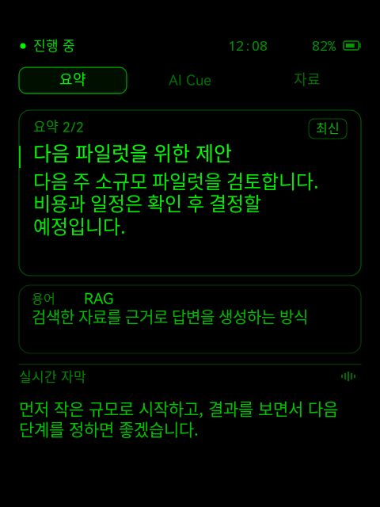

# Rokid Conversate v0.3.1 Preview — Refreshed lens UI

## 한국어

안경 화면을 요약 중심으로 정리했습니다.

- 작은 상태바와 선택 탭, 얇은 윤곽 요약 카드
- 별도 용어 영역과 밝기를 낮춘 하단 자막
- 연결 상태와 큰 6자리 PIN을 갖춘 대기 화면
- 통일된 시작/종료 확인, Cue와 자료 화면
- 큰 글자·긴 문장의 배치 보완 및 언어 처리 수정



예시 데이터와 기기 폰트로 실제 View를 렌더링한 이미지입니다. 개인 회의 내용이 아닙니다.

**[한국어 APK·AI 도우미 설치 안내](https://github.com/hardline7/Rokid-Conversate/blob/v0.3.1/docs/INSTALL.ko.md)**

Assets의 **Windows-Setup.zip**에는 APK·AI 도우미·설치기·한영 안내가 들어 있습니다. APK만 받으면 AI 도우미 설치는 별도입니다. Windows에 ADB와 Node.js 20+/npm을 준비하고 ZIP을 완전히 푼 폴더에서 실행하세요.

```powershell
powershell -NoProfile -ExecutionPolicy Bypass -File .\Install-Conversate.ps1
```

업데이트 전 회의를 종료하세요. 같은 개발 서명을 유지하며 기존 데이터 보존을 확인했지만, 다른 서명으로 빌드된 앱은 교체 전에 기록을 내보내야 합니다. 앱을 자동 삭제하지 않습니다.

## English

A summary-first refresh for the actual glasses interface:

- Compact status bar and selected tabs with thin summary outlines
- Separate terminology panel and quieter captions
- A ready screen with clear connectivity and large pairing digits
- Consistent confirmations, cue history and notes pages
- Better large/long text layout and hardened language handling

**[English APK and AI helper setup](https://github.com/hardline7/Rokid-Conversate/blob/v0.3.1/docs/INSTALL.en.md)**

Choose **Windows-Setup.zip** for the APK, helper sources, installer and both guides. The standalone APK does not provision the AI helper automatically. Install ADB and Node.js 20+/npm, fully extract the ZIP, then run the command above. End meetings before updating. This retains the existing development signing certificate; a differently signed local build may require exporting records before any replacement.

## Validation / 검증

- 34 JVM tests, Android lint and APK build passed.
- 36 Korean/English fixture states rendered by the production View with device fonts in a separate preview process; monochrome/safe-area checks passed and representative images were reviewed.
- Installed on the connected RG_glasses after confirming no active meeting; existing record counts and Rokid AI connectivity verified.
- Images use synthetic data. Pixel rendering does not replace optical comfort, long meeting or battery testing.

## Runtime and distribution / 실행 및 배포

No separate third-party AI API key or application backend is needed. Records and the companion are local; STT and AI use Rokid. Rokid host/phone/cloud communication can still apply, so this is not fully offline AI or zero API calls.

This remains a **development/debug-signed preview**, with the existing separate AI helper setup. APK-only helper installation, official store publication and universal firmware compatibility are not solved by this visual update. The installer preserves its active-recognition and checksum checks. `SHA256SUMS.txt` covers the APK and ZIP.
